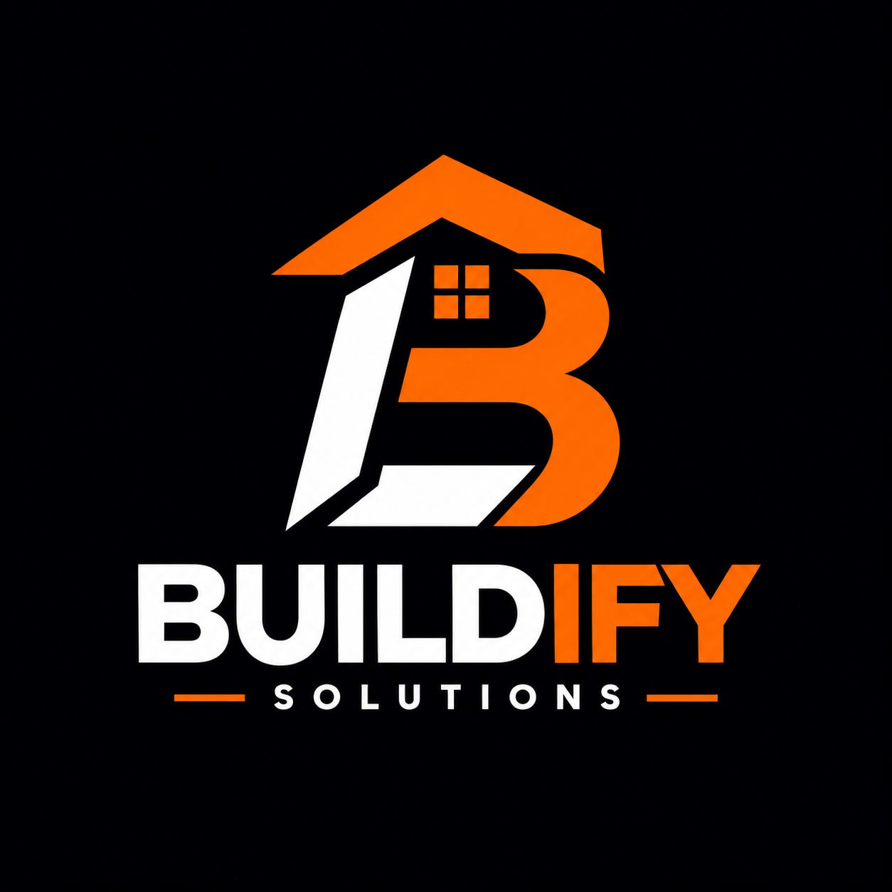
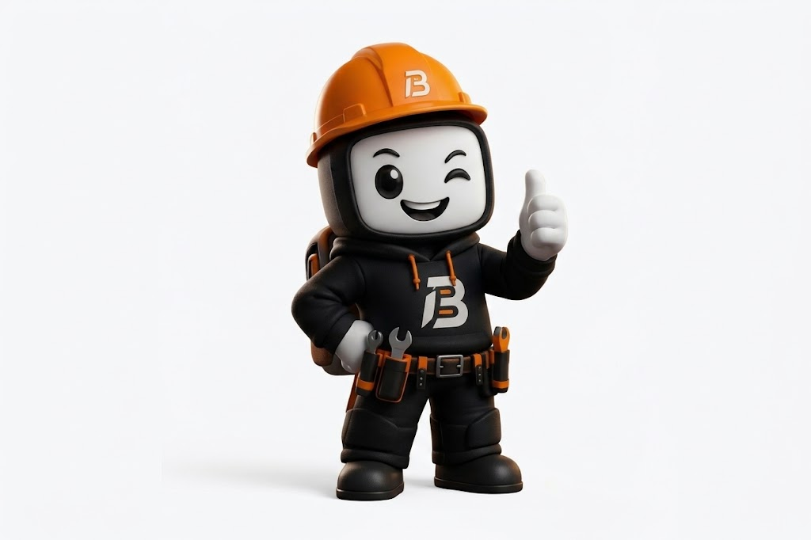
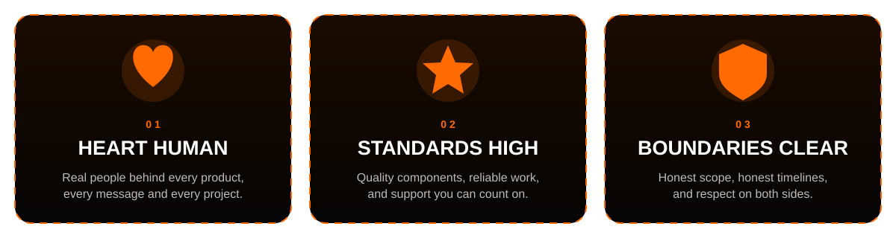
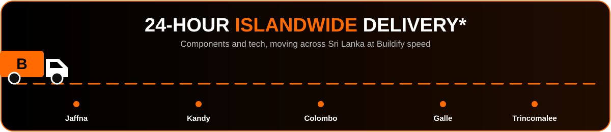
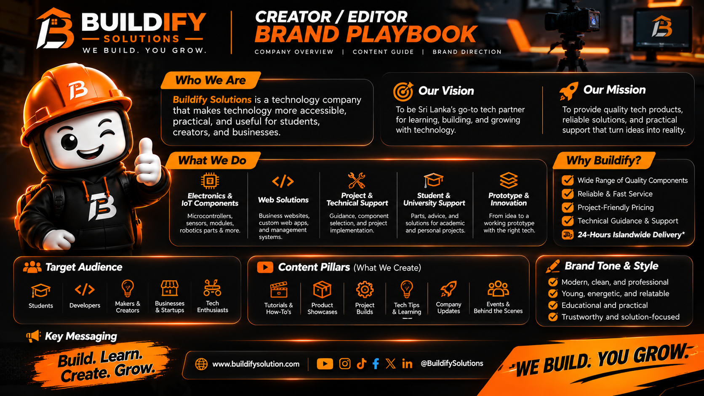

<!-- ============================================================
     BUILDIFY SOLUTIONS — Company Intro / GitHub Profile README
     1. Replace every  buildifysolutions  with your real username
     2. Keep the /assets folder and /.github folder next to this file
     ============================================================ -->

 

 

## 👋 Welcome to Buildify

> **Buildify Solutions** is a technology company that makes technology **more accessible, practical, and useful** for **students, creators, and businesses**.
>
> We sell quality components, build web solutions, and guide projects from the first sketch to a working prototype. We also share everything we learn along the way.

<table>
<tr>
<td width="38%" align="center">

**👷 Our hard-hat mascot is on the job.**
 *Winking. Thumbs up. Tools ready.*

</td>
<td width="62%">

### 🎯 Our Vision
To be **Sri Lanka's go-to tech partner** for learning, building, and growing with technology.

### 🚀 Our Mission
To provide **quality tech products, reliable solutions, and practical support** that turn ideas into reality.

### 💬 Our Message
## **Build. Learn. Create. Grow.**

</td>
</tr>
</table>

## 🧭 Our Promise: The Buildify Code

### *Keep your heart human. Keep your standards high. Keep your boundaries clear.*

## ⚡ What We Do

| 🔌 **Electronics & IoT** | 🌐 **Web Solutions** | 🛠️ **Project & Technical Support** | 🎓 **Student & University Support** | 💡 **Prototype & Innovation** |
|:---:|:---:|:---:|:---:|:---:|
| Microcontrollers, sensors, modules, robotics parts & more | Business websites, custom web apps & management systems | Guidance, component selection & project implementation | Parts, advice & solutions for academic and personal projects | From idea to a working prototype with the right tech |

### 🔄 How an Idea Becomes Real

## 🚚 Fast. Reliable. Islandwide.

\*Delivery timelines may vary by location and availability.

## 🏆 Why Buildify?

| | |
|:---|:---|
| ✅ **Wide range of quality components** | ✅ **Reliable & fast service** |
| ✅ **Project-friendly pricing** | ✅ **Technical guidance & support** |
| 🚚 **24-hour islandwide delivery\*** | 🤝 **Human, honest, solution-focused** |

## 👥 Who We Build For

| 🎓 Students | 👨‍💻 Developers | 🧑‍🔧 Makers & Creators | 🏪 Businesses & Startups | 🤖 Tech Enthusiasts |
|:---:|:---:|:---:|:---:|:---:|

## 🎬 What We Create

We share everything we learn, because **teaching is part of building.**

| 🎞️ Tutorials & How-Tos | 📦 Product Showcases | 🏗️ Project Builds | 💡 Tech Tips & Learning | 🚀 Company Updates | 🎪 Events & Behind the Scenes |
|:---:|:---:|:---:|:---:|:---:|:---:|

## 🧰 Our Tech Playground

## 📊 Open Source Activity

### 🐍 The Buildify Snake Is Hungry

## 🎨 Brand DNA

  

<b>📘 View the full Creator / Editor Brand Playbook</b>

 

## 🤝 Let's Build Something

Got a project, a prototype, or just a wild idea? **Let's make it real.**

- 🛒 Need components for a project? → **[buildifysolution.com](https://www.buildifysolution.com)**
- 🌐 Need a website or management system? → **Send us a message**
- 🎓 Working on a university project? → **We've got your back**
- 💬 Want to collaborate? → **Open an issue or start a discussion**

 

### 🟠 **BUILD. LEARN. CREATE. GROW.** 🟠

